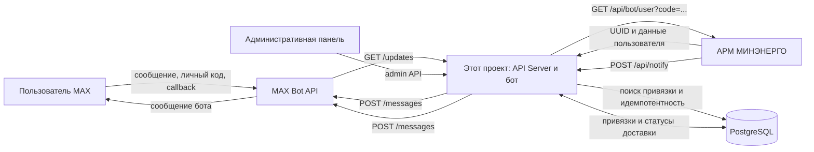
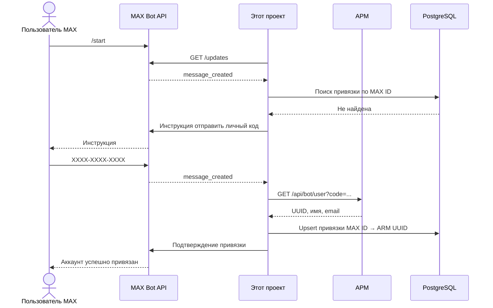
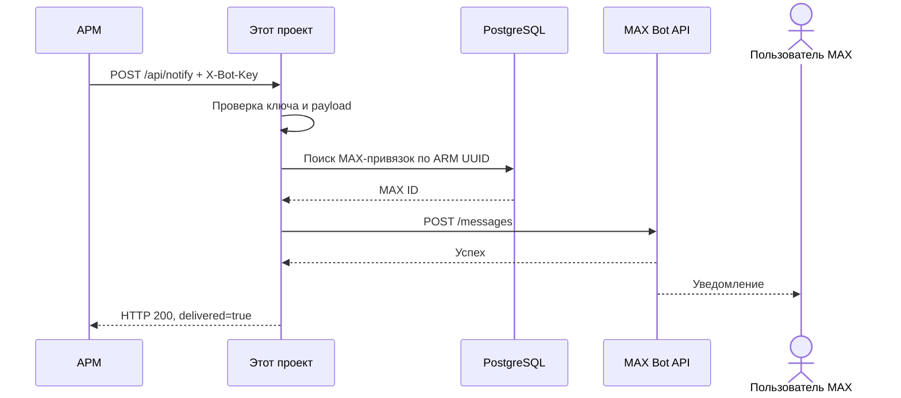
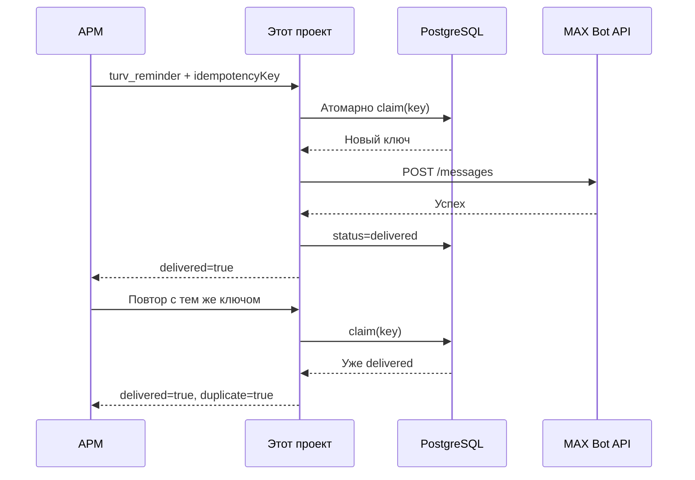

# Интеграция MAX-бота с АРМ МИНЭНЕРГО

## 1. Назначение документа

Этот документ описывает, как текущий проект:

- подключается к платформе MAX;
- принимает сообщения и нажатия кнопок пользователей MAX;
- связывает пользователя MAX с учётной записью АРМ МИНЭНЕРГО;
- получает от АРМ команды на отправку уведомлений;
- доставляет уведомления пользователям MAX;
- хранит локальные связи и состояние доставки;
- разделяет ответственность между этим проектом, АРМ и платформой MAX.

Документ основан на фактической реализации текущего репозитория. Возможности, для
которых в коде есть только заготовки, отмечены отдельно.

---

## 2. Участники интеграции

В обмене участвуют три основные стороны.

### 2.1. Этот проект: API Server и MAX-бот

Этот проект является интеграционным слоем между АРМ и MAX. Он выполняет следующие
задачи:

1. Поддерживает HTTP API для АРМ.
2. Подключается к MAX Bot API по токену бота.
3. Получает события MAX с помощью long polling.
4. Обрабатывает команды, текстовые сообщения и нажатия inline-кнопок.
5. Проверяет личный код пользователя через API АРМ.
6. Хранит локальную связь между идентификатором пользователя MAX и UUID
   пользователя АРМ.
7. Принимает от АРМ уведомления через `POST /api/notify`.
8. Определяет получателя MAX по UUID пользователя АРМ.
9. Отправляет сообщение через MAX Bot API.
10. Ограничивает скорость отправки и повторяет запросы при ответе MAX `429`.
11. Защищает напоминания ТУРВ от повторной отправки по `idempotencyKey`.
12. Предоставляет административную панель для просмотра статуса интеграций и
    управления локальными привязками.

Проект не является источником кадровых, проектных, учебных, КПЭ- или ТУРВ-данных.
Он получает необходимые идентификаторы и сведения от АРМ.

### 2.2. АРМ МИНЭНЕРГО

АРМ является основной бизнес-системой и источником данных. На стороне АРМ должны
выполняться следующие действия:

1. Хранение пользователей, их UUID и личных кодов.
2. Предоставление защищённого API поиска пользователя по личному коду.
3. Хранение и обработка табелей ТУРВ, задач, курсов, КПЭ и других бизнес-данных.
4. Определение момента, события и списка получателей уведомления.
5. Формирование payload для `POST /api/notify`.
6. Для `turv_reminder` — полное формирование итогового текста сообщения, включая:
   - период или неделю;
   - незаполненные дни;
   - переносы строк;
   - необходимую формулировку.
7. Формирование стабильного `idempotencyKey` для каждого напоминания ТУРВ.
8. Передача относительного пути `deepLink`, если в MAX нужна кнопка перехода в
   АРМ.
9. Повтор временно неуспешной отправки, если бот вернул `503` и
   `retryable: true`.

Бот не рассчитывает, заполнен ли табель за текущую неделю. Такой расчёт и решение
об отправке напоминания находятся на стороне АРМ.

### 2.3. Платформа MAX

MAX предоставляет внешнее Bot API и отвечает за:

1. Выдачу и обслуживание токена бота.
2. Хранение пользователей и их MAX ID.
3. Выдачу входящих событий через `/updates`.
4. Приём исходящих сообщений через `/messages`.
5. Обработку ответов на callback-события через `/answers`.
6. Фактическую доставку сообщений внутри мессенджера.
7. Ограничение частоты API-запросов.

Текущий проект не использует входящий webhook MAX. Получение событий построено на
long polling.

---

## 3. Общая архитектура



### Основной принцип

АРМ владеет бизнес-данными и принимает решение, что и кому отправлять. Этот
проект связывает UUID пользователя АРМ с MAX ID и обеспечивает техническую
доставку сообщения.

---

## 4. Компоненты текущего проекта

### 4.1. API Server

API Server — основной постоянно работающий процесс. Он:

- поднимает Express HTTP-сервер на порту из переменной `PORT`;
- предоставляет `/health`, `/api/notify` и административные маршруты;
- запускает цикл MAX long polling при наличии обязательной конфигурации;
- работает с PostgreSQL;
- отправляет запросы в АРМ и MAX.

Если обязательные параметры бота отсутствуют, HTTP-сервер продолжает работать,
а `/health` остаётся доступным. Сам polling бота при этом не запускается.

### 4.2. MAX bot loop

Фоновый цикл:

1. Вызывает MAX `GET /updates`.
2. Передаёт:
   - таймаут long polling — 30 секунд;
   - лимит одной выборки — до 100 событий;
   - `marker` последней обработанной позиции.
3. Обрабатывает полученные события.
4. Сохраняет новый `marker` в памяти и выполняет следующий запрос.
5. При ошибке увеличивает задержку перед повтором вплоть до 30 секунд.

Обрабатываются:

- `message_created` — новое сообщение;
- `message_callback` — нажатие callback-кнопки;
- `bot_started` — начало работы пользователя с ботом.

Callback подтверждается отдельным запросом MAX `/answers`.

### 4.3. PostgreSQL

PostgreSQL хранит:

- привязки пользователей MAX к пользователям АРМ;
- постоянное состояние идемпотентности напоминаний ТУРВ.

Бизнес-данные АРМ в локальную базу не копируются.

### 4.4. Административная панель

Административная панель использует API Server и позволяет:

- войти по административному паролю;
- увидеть наличие обязательной конфигурации без раскрытия значений;
- проверить доступность АРМ и MAX;
- увидеть состояние polling;
- посмотреть количество и список привязок;
- найти привязку;
- удалить локальную привязку пользователя.

Удаление привязки в панели или через кнопку бота не удаляет пользователя в АРМ.

---

## 5. Конфигурация

Проект использует следующие параметры окружения.

| Параметр | Назначение | Ответственная сторона |
|---|---|---|
| `PORT` | Порт HTTP-сервера | Среда запуска проекта |
| `ARM_BASE_URL` | Базовый URL опубликованного АРМ | Владелец интеграции |
| `ARM_SECRET` | Общий ключ для запросов между АРМ и ботом | АРМ и этот проект |
| `MAX_BOT_TOKEN` | Токен доступа к MAX Bot API | Владелец MAX-бота |
| `DATABASE_URL` | Подключение к PostgreSQL | Среда запуска проекта |
| `ADMIN_PASSWORD` | Пароль административной панели | Администратор проекта |
| `SESSION_SECRET` | Подпись сессии административной панели | Администратор проекта |
| `ENABLE_BOT_POLLING` | Явное включение или отключение polling | Оператор проекта |

Значения секретов нельзя записывать в документацию, исходный код, логи или
передавать в пользовательский интерфейс.

### Правило единственного polling-процесса

Для одного `MAX_BOT_TOKEN` должен работать только один long-polling процесс.

Если одновременно включить polling в development и production:

- оба процесса могут получить или обработать одни и те же события;
- пользователь может увидеть дубли ответов;
- поведение `marker` станет непредсказуемым.

По умолчанию polling:

- отключён в development;
- включён в production;
- может быть явно переопределён через `ENABLE_BOT_POLLING`.

Перед ручным включением polling в development необходимо остановить production
poller.

---

## 6. Подключение проекта к MAX

### 6.1. Авторизация в MAX

Все запросы к MAX выполняются по адресу:

`https://platform-api.max.ru`

Токен передаётся в HTTP-заголовке:

```http
Authorization: <MAX_BOT_TOKEN>
Content-Type: application/json
```

Токен в query string не передаётся.

### 6.2. Получение входящих событий

Проект выполняет:

```http
GET /updates?timeout=30&limit=100&marker=<marker>
```

`marker` отсутствует в первом запросе и добавляется после получения первой
пачки событий.

### 6.3. Отправка сообщения

Для отправки используется:

```http
POST /messages?user_id=<MAX_USER_ID>
```

Тело содержит текст и, при необходимости, inline-клавиатуру:

```json
{
  "text": "Текст сообщения",
  "attachments": [
    {
      "type": "inline_keyboard",
      "payload": {
        "buttons": []
      }
    }
  ]
}
```

MAX ID преобразуется в строку. Это исключает потерю точности для больших
числовых идентификаторов.

---

## 7. Привязка пользователя MAX к АРМ

### 7.1. Роли в сценарии

**Пользователь MAX:**

1. Запускает бота.
2. Получает просьбу указать личный код из профиля АРМ.
3. Отправляет код в формате `XXXX-XXXX-XXXX`.

**Этот проект:**

1. Извлекает код из сообщения.
2. Переводит код в верхний регистр.
3. Передаёт код в АРМ.
4. Получает UUID и данные пользователя.
5. Сохраняет привязку.
6. Подтверждает привязку пользователю MAX.

**АРМ:**

1. Принимает личный код.
2. Проверяет его в собственной базе.
3. Возвращает данные найденного пользователя или ошибку.

### 7.2. Запрос в АРМ

Этот проект выполняет:

```http
GET <ARM_BASE_URL>/api/bot/user?code=XXXX-XXXX-XXXX
X-Bot-Key: <ARM_SECRET>
Accept: application/json
```

Ожидаемый ответ пользователя:

```json
{
  "id": "UUID пользователя АРМ",
  "username": "Имя пользователя",
  "email": "email при наличии",
  "linkCode": "личный код при наличии"
}
```

Поле `id` обязательно для успешной привязки.

### 7.3. Локально сохраняемые данные

В таблице `bot_bindings` сохраняются:

| Поле | Источник | Назначение |
|---|---|---|
| `max_user_id` | MAX | Получатель сообщений MAX |
| `arm_user_id` | АРМ | UUID пользователя в АРМ |
| `username` | АРМ | Отображение имени в боте и админке |
| `email` | АРМ | Отображение профиля |
| `link_code` | АРМ или введённый код | Отображение профиля и диагностика |
| `created_at` | Этот проект | Дата создания |
| `updated_at` | Этот проект | Дата обновления |

`max_user_id` хранится как текст, чтобы не потерять точность большого MAX ID.

При повторной привязке одного MAX-пользователя запись обновляется.

Один UUID пользователя АРМ может соответствовать нескольким локальным MAX
привязкам. При уведомлении проект пытается доставить сообщение по каждой найденной
привязке.

### 7.4. Ошибки привязки

| Ситуация | Действие проекта |
|---|---|
| Код не соответствует формату | Повторно показывает инструкцию по привязке |
| АРМ вернул `404` | Сообщает, что пользователь не найден |
| АРМ недоступен | Просит повторить попытку позже |
| Ответ не содержит UUID | Считает пользователя не найденным |
| Успешный ответ | Сохраняет связь и подтверждает привязку |

### 7.5. Отвязка

Отвязка выполняется только в локальной базе этого проекта:

1. Пользователь нажимает кнопку «Отвязать» или администратор удаляет привязку.
2. Запись удаляется из `bot_bindings`.
3. АРМ не вызывается.
4. Учётная запись и личный код в АРМ не меняются.
5. Для повторной привязки пользователь снова отправляет личный код.

---

## 8. Какие данные проект получает из АРМ

### 8.1. Реально используемый источник

В текущей реализации реально используется:

```http
GET /api/bot/user?code=<личный код>
```

Он нужен только для связывания пользователя MAX с UUID АРМ.

### 8.2. Подготовленные, но не используемые источники

В ARM-клиенте подготовлены обёртки:

```http
GET /api/bot/employee?userId=<UUID>
GET /api/bot/timesheets?userId=<UUID>
GET /api/bot/kpi?userId=<UUID>
GET /api/bot/tasks?userId=<UUID>
```

Однако текущая логика бота их не вызывает, а типы ответов не зафиксированы.
Следовательно, нельзя считать реализованными:

- просмотр табелей из MAX;
- получение КПЭ из АРМ по запросу пользователя;
- получение задач или профиля сотрудника;
- расчёт незаполненных дней ТУРВ внутри бота.

Эти функции требуют отдельного контракта и реализации на стороне АРМ.

### 8.3. Данные для уведомлений

Для уведомлений АРМ не ожидает, что бот сам запросит бизнес-объект. АРМ передаёт
необходимые поля непосредственно в `POST /api/notify`.

---

## 9. Приём уведомлений от АРМ

### 9.1. Endpoint

АРМ вызывает:

```http
POST <MAX_BOT_URL>/api/notify
Content-Type: application/json
X-Bot-Key: <ARM_SECRET>
```

`X-Bot-Key` проверяется этим проектом до обработки payload.

### 9.2. Общие поля

```json
{
  "type": "тип события",
  "toArmUserId": "UUID получателя в АРМ",
  "deepLink": "/относительный/путь"
}
```

Обязательны:

- `type`;
- `toArmUserId`.

`toArmUserId` — это UUID АРМ, а не MAX ID и не личный код.

Проект находит все строки `bot_bindings` с этим `arm_user_id`, извлекает MAX ID и
отправляет сообщение.

### 9.3. Поддерживаемые типы

| Тип | Назначение | Кто формирует текст |
|---|---|---|
| `turv_submitted` | Табель отправлен руководителю | Этот проект по полям payload |
| `turv_approved` | Табель согласован | Этот проект |
| `turv_rejected` | Табель возвращён | Этот проект |
| `turv_reminder` | Напоминание о незаполненном ТУРВ | Полностью АРМ |
| `task_assigned` | Назначена задача | Этот проект |
| `task_co_assigned` | Назначено соисполнение | Этот проект |
| `training_course_assigned` | Назначен курс | Этот проект |
| `kpi_assigned` | Назначены КПЭ | Этот проект |
| `kpi_revision` | КПЭ возвращены на доработку | Этот проект |

Дополнительные поля зависят от события:

- `fromName` — инициатор или сотрудник;
- `period` — период табеля или КПЭ;
- `comment` — причина возврата или комментарий;
- `title` — название задачи;
- `courseTitle` — название курса;
- `message` — готовый текст `turv_reminder`;
- `idempotencyKey` — ключ `turv_reminder`;
- `deepLink` — относительный путь в АРМ.

---

## 10. Напоминание `turv_reminder`

### 10.1. Разделение ответственности

**АРМ:**

- проверяет состояние табелей;
- определяет текущую неделю;
- определяет незаполненные дни;
- выбирает получателя;
- формирует окончательный текст;
- создаёт стабильный `idempotencyKey`;
- вызывает webhook.

**Этот проект:**

- проверяет авторизацию и поля payload;
- находит MAX-привязку по UUID АРМ;
- передаёт `message` в MAX без изменения;
- добавляет кнопку только на основе `deepLink`;
- не допускает повторную отправку одного ключа;
- возвращает результат доставки.

Бот не должен:

- обрезать текст;
- исправлять формулировки;
- добавлять период;
- переводить текст;
- менять переносы строк;
- добавлять служебные данные.

### 10.2. Обязательные поля

Для `turv_reminder` дополнительно обязательны:

- непустой `message`;
- непустой `idempotencyKey`.

Пример:

```json
{
  "type": "turv_reminder",
  "toArmUserId": "ba2bde5b-5da5-4fca-89ef-c257918c7976",
  "message": "Напоминание о заполнении ТУРВ\n\nНеделя: 24.08–28.08\nНе отправлен табель:\n• вторник, 25.08",
  "idempotencyKey": "turv-reminder:2026-08-25:ba2bde5b-5da5-4fca-89ef-c257918c7976",
  "deepLink": "/turv"
}
```

Фраза «Откройте раздел ТУРВ в АРМ» в этот пример намеренно не включена. Если её
нужно исключить из рабочих сообщений, изменение должно быть сделано в
формирователе текста на стороне АРМ.

### 10.3. Идемпотентность

Таблица `notification_deliveries` хранит:

- `idempotency_key`;
- статус `processing` или `delivered`;
- даты создания и обновления.

Последовательность:

1. Проект атомарно пытается создать запись `processing`.
2. Если ключ новый, запрос получает право на отправку.
3. Если ключ уже `delivered`, возвращается успешный ответ с
   `duplicate: true`.
4. Если другой запрос обрабатывает ключ, проект ожидает результат.
5. После успешной отправки статус меняется на `delivered`.
6. Если ни одно сообщение не принято MAX, claim освобождается, чтобы АРМ мог
   повторить запрос.
7. Если MAX мог принять хотя бы одно сообщение, claim сохраняется: его нельзя
   освобождать, иначе повтор АРМ может создать дубликат.

Идемпотентность постоянная и сохраняется после перезапуска процесса.

### 10.4. Рекомендуемая структура ключа

Ключ должен однозначно определять логическое напоминание, например:

```text
turv-reminder:<дата проверки>:<UUID пользователя>
```

АРМ должен повторять временно неуспешный webhook с тем же ключом, а не
генерировать новый ключ на каждую сетевую попытку.

---

## 11. Deep link и кнопка MAX

АРМ может передать:

```json
{
  "deepLink": "/turv"
}
```

Проект:

1. Принимает только относительный путь.
2. Отклоняет URL со схемами `http:`, `https:`, `javascript:`, `mailto:` и
   protocol-relative адреса `//...`.
3. Добавляет путь к `ARM_BASE_URL`.
4. Создаёт MAX-кнопку «Открыть в АРМ».

Если `deepLink` отсутствует, некорректен или конфигурация АРМ недоступна,
сообщение всё равно может быть отправлено без кнопки.

Текст «Откройте раздел ТУРВ в АРМ» и кнопка «Открыть в АРМ» — разные элементы.
Удаление фразы из текста не удаляет кнопку.

---

## 12. Ограничение скорости MAX и повтор при `429`

MAX ограничивает Bot API частотой до 30 запросов в секунду.

Все вызовы отправки сообщений в текущем процессе используют общий ограничитель:

- минимальный интервал между отправками — 50 мс;
- целевая скорость — около 20 сообщений в секунду;
- это оставляет запас относительно лимита MAX.

Если MAX отвечает `429`:

1. Первая повторная попытка выполняется после 1 секунды.
2. Вторая — после 2 секунд.
3. Третья — после 4 секунд.
4. Всего возможно четыре обращения: первоначальное и три повтора.

Если последняя попытка неуспешна, отправка считается ошибочной.

Ограничитель находится в памяти одного процесса. Поэтому требование одного
production-процесса важно не только для polling, но и для предсказуемого общего
лимита исходящих запросов.

---

## 13. Результаты `POST /api/notify`

### 13.1. Успешная доставка

```http
HTTP 200
```

```json
{
  "ok": true,
  "delivered": true,
  "idempotencyKey": "..."
}
```

### 13.2. Повтор уже доставленного напоминания

```http
HTTP 200
```

```json
{
  "ok": true,
  "delivered": true,
  "duplicate": true,
  "idempotencyKey": "..."
}
```

АРМ должен считать это успешным терминальным результатом и не продолжать
повторы.

### 13.3. Пользователь не привязан

Для `turv_reminder`:

```http
HTTP 200
```

```json
{
  "ok": false,
  "delivered": false,
  "skipped": true,
  "reason": "recipient_not_linked",
  "idempotencyKey": "..."
}
```

Это терминальный результат для данного получателя. Повтор без новой привязки не
решит проблему.

### 13.4. Невалидный payload

```http
HTTP 400
```

```json
{
  "ok": false,
  "delivered": false,
  "retryable": false,
  "reason": "invalid_payload",
  "missing": ["message", "idempotencyKey"]
}
```

АРМ должен исправить payload. Автоматический повтор того же запроса не поможет.

### 13.5. Временная ошибка доставки

```http
HTTP 503
```

```json
{
  "ok": false,
  "delivered": false,
  "retryable": true,
  "reason": "max_api_temporary_error",
  "idempotencyKey": "..."
}
```

АРМ может повторить запрос с тем же `idempotencyKey`.

### 13.6. Неожиданная внутренняя ошибка

Необработанная ошибка возвращает HTTP `500`. Она требует проверки логов и
состояния сервиса.

---

## 14. Полные последовательности действий

### 14.1. Первый запуск и привязка



### 14.2. Уведомление от АРМ



### 14.3. Идемпотентное напоминание ТУРВ



---

## 15. Контроль доступности

### 15.1. HTTP health

`GET /health` проверяет, что HTTP-сервис запущен. Endpoint продолжает отвечать,
даже если конфигурации MAX или АРМ не хватает и polling не стартовал.

Поэтому HTTP `200` от `/health` не означает автоматически, что:

- токен MAX корректен;
- АРМ доступен;
- polling включён;
- база данных доступна для всех операций;
- уведомление будет доставлено.

### 15.2. Проверка MAX

Проверка MAX выполняется запросом:

```http
GET https://platform-api.max.ru/me
Authorization: <MAX_BOT_TOKEN>
```

Успешный ответ подтверждает доступность MAX и валидность токена.

### 15.3. Проверка АРМ

Проект выполняет запрос поиска с заведомо несуществующим кодом. Любой HTTP-ответ
подтверждает сетевую доступность АРМ. Это не является проверкой всех API АРМ.

---

## 16. Матрица ответственности

| Действие | Этот проект | АРМ | MAX |
|---|---:|---:|---:|
| Хранить пользователей организации | Нет | Да | Только MAX-профили |
| Хранить табели, задачи, курсы и КПЭ | Нет | Да | Нет |
| Выдавать личный код | Нет | Да | Нет |
| Проверять личный код | Вызывает API | Да | Нет |
| Хранить MAX ID | Да, в привязке | Может не хранить | Да |
| Связывать MAX ID и ARM UUID | Да | Возвращает UUID | Возвращает MAX ID |
| Определять незаполненные табели | Нет | Да | Нет |
| Формировать текст `turv_reminder` | Нет | Да | Нет |
| Принимать webhook АРМ | Да | Вызывает | Нет |
| Защищать `turv_reminder` от дублей | Да | Повторяет тот же ключ | Нет |
| Ограничивать скорость исходящих запросов | Да | Нет | Устанавливает лимит |
| Доставлять сообщение в мессенджере | Инициирует | Нет | Да |
| Повторять webhook после `503` | Нет | Да | Нет |
| Показывать кнопку перехода в АРМ | Формирует кнопку | Передаёт путь | Отображает |

---

## 17. Типичные проблемы и действия

| Симптом | Вероятная причина | Где проверять | Ответственная сторона |
|---|---|---|---|
| `/health` работает, бот не отвечает | Polling отключён или нет конфигурации | Логи запуска, наличие параметров | Этот проект |
| Ответы бота дублируются | Два процесса polling на одном токене | Development и production | Оператор проекта |
| Личный код не найден | Ошибка кода или пользователь отсутствует | АРМ `/api/bot/user` | Пользователь/АРМ |
| «Не удалось связаться с АРМ» | АРМ или сеть недоступны | ARM status и логи | АРМ/инфраструктура |
| Уведомление пропущено | Нет локальной MAX-привязки | `bot_bindings`, админка | Пользователь/администратор |
| HTTP `400` от notify | Невалидные или отсутствующие поля | Payload АРМ | АРМ |
| HTTP `401` от notify | Неверный `X-Bot-Key` | Секреты обеих систем | АРМ/этот проект |
| HTTP `503`, `retryable=true` | Временная ошибка MAX или доставки | Логи API Server | АРМ повторяет, проект диагностирует |
| MAX отвечает `429` | Слишком много запросов | Логи MAX-клиента | Проект повторяет автоматически |
| Неверный текст `turv_reminder` | Текст сформирован в АРМ | Генератор уведомления АРМ | АРМ |
| Нет кнопки «Открыть в АРМ» | Нет или отклонён `deepLink` | Payload и `ARM_BASE_URL` | АРМ/этот проект |

---

## 18. Требования к эксплуатации

1. API Server должен работать как постоянно запущенный процесс.
2. Для production нужен режим, подходящий для long-running сервиса, поскольку
   polling должен выполняться постоянно.
3. На один токен MAX допускается один активный poller.
4. После изменения секретов необходимо проверить отдельно:
   - доступность MAX;
   - доступность АРМ;
   - авторизацию `POST /api/notify`;
   - polling.
5. Нельзя использовать MAX ID как число в локальном хранении или промежуточных
   преобразованиях.
6. Нельзя освобождать ключ идемпотентности, если MAX уже мог принять сообщение.
7. При `503` АРМ должен повторять webhook с тем же `idempotencyKey`.
8. При `skipped: true` повторять уведомление бессмысленно до появления привязки.
9. Изменения текстов `turv_reminder` выполняются в АРМ, а не в этом проекте.
10. Перед тестовым включением polling в development production poller необходимо
    остановить.

---

## 19. Безопасность

### 19.1. Межсистемный ключ

Один и тот же логический секрет используется:

- этим проектом в исходящих запросах к АРМ;
- АРМ в заголовке входящего `POST /api/notify`.

Сравнение входящего ключа выполняется безопасным способом. Запрос без корректного
ключа не должен доходить до обработки уведомления.

### 19.2. MAX-токен

`MAX_BOT_TOKEN` используется только сервером. Он не передаётся в
административный frontend и не должен выводиться в status API.

### 19.3. Deep link

Разрешены только относительные пути АРМ. Это предотвращает добавление внешней или
вредоносной ссылки даже отправителем с корректным межсистемным ключом.

### 19.4. Локальные персональные данные

Проект сохраняет имя, email и личный код, полученные при привязке. Доступ к
административному списку должен быть защищён. В логи и пользовательские ошибки
не следует добавлять значения секретов.

---

## 20. Границы текущей реализации

Подтверждено текущим кодом:

- MAX long polling;
- обработка сообщений и callback-кнопок;
- привязка по личному коду;
- локальная отвязка;
- поиск пользователя через АРМ;
- входящий webhook уведомлений;
- доставка в MAX;
- глобальное ограничение скорости;
- повтор при `429`;
- идемпотентность `turv_reminder`;
- безопасная обработка относительного `deepLink`;
- административный статус и управление привязками.

Не следует считать реализованным без дополнительной разработки:

- получение и отображение табелей по запросу пользователя MAX;
- получение КПЭ или задач из АРМ по запросу пользователя;
- расчёт текущей недели и незаполненных дней внутри бота;
- запуск расписания напоминаний внутри этого проекта;
- хранение бизнес-данных АРМ в локальной базе;
- управление пользователями или табелями АРМ через административную панель бота.

Главная граница ответственности: **АРМ формирует бизнес-событие и его данные,
этот проект обеспечивает связь с пользователем и техническую доставку, MAX
доставляет сообщение внутри мессенджера.**